
<a href="./README.zh-CN.md">返回正式主页</a> · <strong>ATLAS / 研究档案 · 组合预览</strong>

<!-- singularity-art -->

  <picture>
    <source media="(prefers-color-scheme: dark)" srcset="./assets/atlas-preview/hero-dark.svg">
    
  </picture>

<!-- opening-verse -->

  <a href="https://github.com/DenverCoder1/readme-typing-svg"><picture>
    <source media="(prefers-color-scheme: dark)" srcset="https://readme-typing-svg.demolab.com/?font=Noto%20Serif%20SC&amp;size=22&amp;duration=3800&amp;pause=4800&amp;color=B8C6DD&amp;center=true&amp;vCenter=true&amp;width=760&amp;height=48&amp;repeat=false&amp;lines=%E8%A1%8C%E5%88%B0%E6%B0%B4%E7%A9%B7%E5%A4%84%EF%BC%8C%E5%9D%90%E7%9C%8B%E4%BA%91%E8%B5%B7%E6%97%B6%E3%80%82">
    
  </picture></a>

<strong>档案索引</strong> · <a href="#research">01 研究兴趣</a> &nbsp; / &nbsp; <a href="#projects">02 项目与研究</a> &nbsp; / &nbsp; <a href="#activity">03 开源活动</a> &nbsp; / &nbsp; <a href="#garden">04 盆景与猫</a>

## 01 · 研究兴趣

<table width="100%">
<tr><td width="100%"><picture><source media="(prefers-color-scheme: dark)" srcset="./assets/atlas-preview/section-research-dark.svg">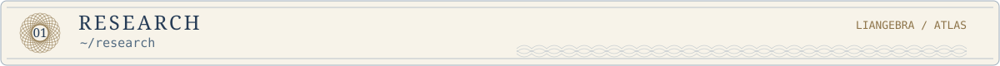</picture></td></tr>
<tr><td width="100%">

我目前是数学与应用数学专业的本科生，比较喜欢拓扑、代数这类偏结构的数学。比起单纯的计算，我更感兴趣的是一个定义为什么会这样提出，以及我们是怎样理解数学对象的。

最近主要在做 LeanDuet，也在参与一些 Lean 的开源工作。其他一些仓库是之前做数学建模时留下的，或者只是觉得有意思就做了。

  <a href="https://github.com/hereisVaibhav/termfolio"></a>
   
  <a href="https://github.com/hereisVaibhav/termfolio">Termfolio / ~/.plan</a>

</td></tr>
<tr><td align="right"><a href="#research">~/research</a> · <a href="./README.zh-CN.md">正式主页</a></td></tr>
</table>

## 02 · 项目与研究

<table width="100%">
<tr><td width="100%"><picture><source media="(prefers-color-scheme: dark)" srcset="./assets/atlas-preview/section-projects-dark.svg">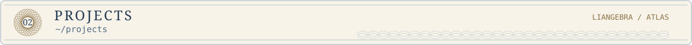</picture></td></tr>
<tr><td width="100%">
<h3><a href="https://github.com/Liangebra/leanduet">LeanDuet</a></h3>

<em>数学语言与形式化</em>

做这个项目最初是想看看能否让数学家直接用平时写数学的方式去使用 Lean。但我觉得比较困难的其实不只是语言的翻译，而是如何理解这两种语言所表达的数学结构。

目前的想法是让它们共用一个数学语义结构，并允许从两边进行修改。这个项目还有很多地方没有解决。

<a href="https://liangebra.github.io/leanduet/">在线体验</a> / <a href="https://github.com/Liangebra/leanduet/blob/main/docs/RESEARCH.md">研究笔记</a> / <a href="https://github.com/Liangebra/leanduet/discussions">讨论</a>

<h3>理论研究与形式化数学</h3>
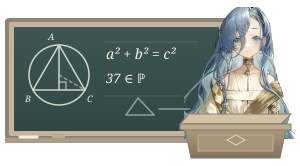

<strong><a href="https://github.com/Liangebra/computational-metaknowledge">Computational Metaknowledge</a></strong>

之前做的一个关于可计算性及 Agent 能够知道什么的研究。 · <a href="https://github.com/Liangebra/computational-metaknowledge/blob/main/paper/ResearchReport.pdf">论文</a>

<strong><a href="https://github.com/leanprover-community/riemann-hypothesis">黎曼猜想社区项目</a></strong>

主要在做一些证明可读性、数学抽象及冗余依赖方面的工作。 · <a href="https://github.com/leanprover-community/riemann-hypothesis/pulls?q=is%3Apr+author%3ALiangebra">我的 PR</a>

<h3>DeepSeek Harness 插件生态</h3>
<!-- dsh-whale-girl-strip -->

  
  
  
  
  

我也在为 <a href="https://github.com/deepseek-ai/deepseek-harness">DeepSeek Harness</a> 开发插件，主要关注 Agent 的上下文管理与交互方式。

<strong>我开发的插件</strong>

<a href="https://github.com/Liangebra/dsh-smart-compact">dsh-smart-compact</a>：智能上下文压缩引擎，支持可配置阈值、自动压缩、DCP 风格去重与清理建议，并通过会话日志保留原始事件。

<a href="https://github.com/Liangebra/dsh-esc-enter">dsh-esc-enter</a>：交互插件，支持 Esc 取消当前回合、追加与停止按钮，保留宿主的任务队列语义。

<strong>社区贡献</strong>

<a href="https://github.com/vlln/whale-girl">whale-girl</a>：新增独立桌面伴侣，支持透明置顶窗口与插件状态实时同步。 <a href="https://github.com/vlln/whale-girl/pull/8">已合并的 PR #8</a>。

<a href="https://github.com/MAXeaglet/dsh-bash-terminal">dsh-bash-terminal</a>：通过直接接入 <code>node-pty</code> 修复 Windows 交互式终端的兼容性问题。 <a href="https://github.com/MAXeaglet/dsh-bash-terminal/pull/2">已合并的 PR #2</a>。

<h3>数学建模与软件开发</h3>

<strong><a href="https://github.com/Liangebra/green-electricity-SGABM">Green Electricity SG-ABM</a></strong>

绿电市场的多智能体仿真模型。

<strong><a href="https://github.com/Liangebra/MathModelEvaluator">MathModelEvaluator</a></strong>

之前做一道数模题时觉得这个东西挺有意思，就单独做成了工具。

<strong><a href="https://github.com/Liangebra/Nubook">NuBook</a></strong>

一个自己做的极简 Android 记账本。

如果对这些项目感兴趣，可以直接在对应仓库里提 Issue 或发起讨论。也很希望能和对 Lean、类型论或者数学语言感兴趣的朋友交流。

</td></tr>
<tr><td align="right"><a href="#projects">~/projects</a> · <a href="./README.zh-CN.md">正式主页</a></td></tr>
</table>

## 03 · 开源活动

<table width="100%">
<tr><td width="100%"><picture><source media="(prefers-color-scheme: dark)" srcset="./assets/atlas-preview/section-activity-dark.svg">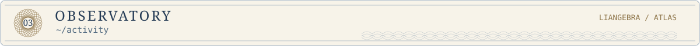</picture></td></tr>
<tr><td width="100%">

这里记录了过去一年的 GitHub 活动。

  <picture>
    <source media="(prefers-color-scheme: dark)" srcset="./assets/atlas-preview/telemetry-dark.svg">
    
  </picture>

<picture><source media="(prefers-color-scheme: dark)" srcset="./assets/atlas-preview/certificate-dark.svg"></picture>

<picture><source media="(prefers-color-scheme: dark)" srcset="./assets/atlas-preview/coupons-dark.svg"></picture>

星空轨道、雕版纹章与月度票券均使用同一份 GitHub 贡献快照。

<!-- contribution-art -->
<h3>贡献记录与统计</h3>

  <a href="https://github.com/vn7n24fzkq/github-profile-summary-cards"><picture><source media="(prefers-color-scheme: dark)" srcset="https://github-profile-summary-cards.vercel.app/api/cards/profile-details?username=Liangebra&amp;theme=tokyonight"></picture></a>

  <a href="https://github.com/vn7n24fzkq/github-profile-summary-cards"><picture><source media="(prefers-color-scheme: dark)" srcset="https://github-profile-summary-cards.vercel.app/api/cards/stats?username=Liangebra&amp;theme=tokyonight"></picture></a>
  <a href="https://github.com/vn7n24fzkq/github-profile-summary-cards"><picture><source media="(prefers-color-scheme: dark)" srcset="https://github-profile-summary-cards.vercel.app/api/cards/repos-per-language?username=Liangebra&amp;theme=tokyonight"></picture></a>
   
  活动概况与语言分布 · <a href="https://github.com/vn7n24fzkq/github-profile-summary-cards">Summary Cards</a>

<h3>贡献记录的可视化</h3>

  <a href="https://github.com/yoshi389111/github-profile-3d-contrib">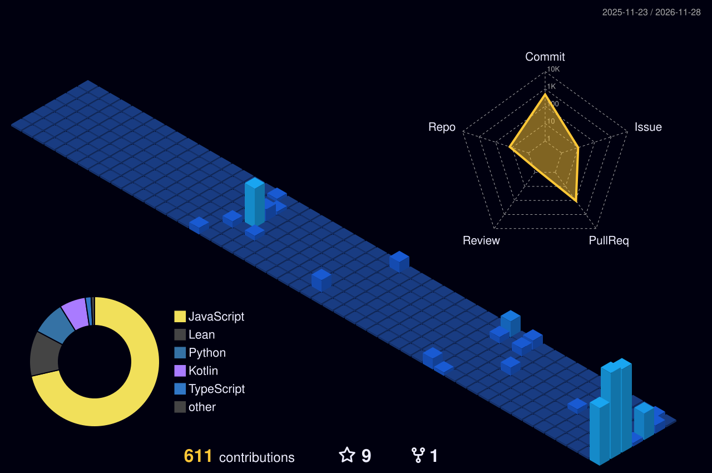</a>
   
  <a href="https://github.com/yoshi389111/github-profile-3d-contrib">3D Contrib</a>

  <a href="https://github.com/abozanona/pacman-contribution-graph"><picture>
    <source media="(prefers-color-scheme: dark)" srcset="./assets/generated/pacman-contribution-graph-dark.svg">
    
  </picture></a>
   
  <a href="https://github.com/abozanona/pacman-contribution-graph">Pac-Man</a>

<!-- monkey-civilization -->

  <a href="https://github.com/jihoo12/monkeys"></a>
   
  <a href="https://github.com/jihoo12/monkeys">Monkey Civilization</a> · 由贡献记录驱动的像素文明

</td></tr>
<tr><td align="right"><a href="#activity">~/activity</a> · <a href="./README.zh-CN.md">正式主页</a></td></tr>
</table>

## 04 · 盆景与猫

<table width="100%">
<tr><td width="100%"><picture><source media="(prefers-color-scheme: dark)" srcset="./assets/atlas-preview/section-garden-dark.svg">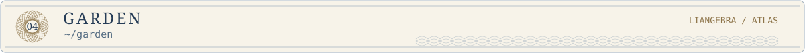</picture></td></tr>
<tr><td width="100%">
<!-- yourtomo-pet -->

  <a href="https://github.com/knowprasad/YourTomo"><picture>
    <source media="(prefers-color-scheme: dark)" srcset="./assets/pet/pet.svg">
    
  </picture></a>
   
  <a href="https://github.com/knowprasad/YourTomo">一只随 GitHub 活动变化的猫。 · YourTomo</a>

<!-- git-bonsai -->

  <a href="https://github.com/egorthinks/git-bonsai">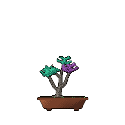</a>
   
  <a href="https://github.com/egorthinks/git-bonsai">一棵用 GitHub 记录养出来的盆景。 · Git Bonsai</a>

</td></tr>
<tr><td align="right"><a href="#garden">~/garden</a> · <a href="./README.zh-CN.md">正式主页</a></td></tr>
</table>

星空与雕版艺术来自 <a href="https://github.com/Dr-At0mic/README-Templates">README Templates</a> · Termfolio 与其他组件保留原有署名。

