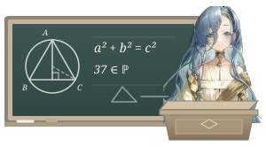
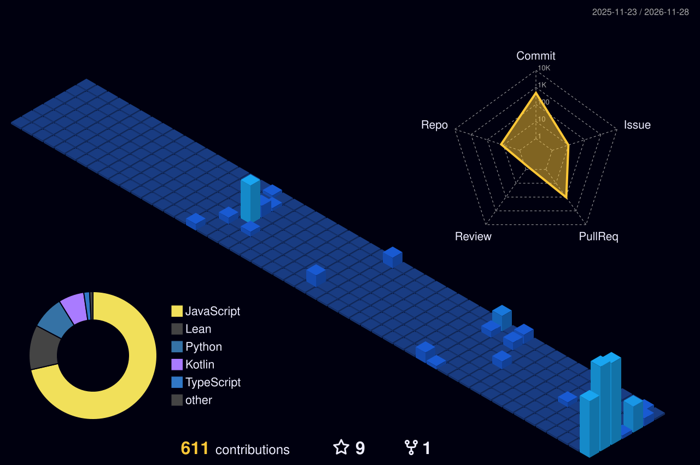
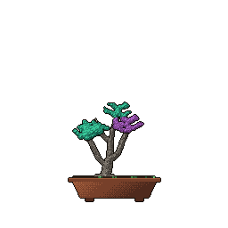

<a href="https://github.com/Liangebra">English</a> &nbsp; / &nbsp; <a href="https://github.com/Liangebra/Liangebra/blob/main/README.zh-CN.md">简体中文</a> &nbsp; / &nbsp; <strong>日本語</strong>

<!-- singularity-art -->

  <picture>
    <source media="(prefers-color-scheme: dark)" srcset="./assets/singularity/hero-dark.svg">
    
  </picture>

<!-- opening-verse -->

  <a href="https://github.com/DenverCoder1/readme-typing-svg"><picture>
    <source media="(prefers-color-scheme: dark)" srcset="https://readme-typing-svg.demolab.com/?font=Noto%20Serif%20JP&amp;size=22&amp;duration=3800&amp;pause=4800&amp;color=B8C6DD&amp;center=true&amp;vCenter=true&amp;width=760&amp;height=48&amp;repeat=false&amp;lines=%E6%B0%B4%E3%81%AE%E5%B0%BD%E3%81%8D%E3%82%8B%E3%81%A8%E3%81%93%E3%82%8D%E3%80%81%E5%BA%A7%E3%81%97%E3%81%A6%E9%9B%B2%E3%81%AE%E8%B5%B7%E3%81%93%E3%82%8B%E3%82%92%E7%9C%8B%E3%82%8B%E3%80%82">
    
  </picture></a>

## 関心分野

数学・応用数学を専攻する学部生です。特に位相数学や代数学など、数学の構造に関わる分野が好きです。計算そのものよりも、なぜその定義が考えられたのか、数学的対象をどう理解するのかに興味があります。

最近は主に LeanDuet を開発しながら、Lean のオープンソース活動にも参加しています。他のリポジトリには、数学モデリングのコンテストをきっかけに作ったものや、面白そうだと思って試したものがあります。

  
   
  <a href="https://github.com/hereisVaibhav/termfolio">Termfolio / ~/.plan</a>

## プロジェクトと研究

### [LeanDuet](https://github.com/Liangebra/leanduet)

*数学言語と形式化*

数学者が普段数学を書くような形で Lean を使えないか、と思って始めたプロジェクトです。難しいのは単なる翻訳ではなく、二つの言語が表している数学的構造を理解することだと思っています。

今は共通の数学的意味構造を持たせ、どちらの側からも編集できるようにしたいと考えています。まだ解決すべきことは多いです。

[オンライン版](https://liangebra.github.io/leanduet/) / [研究ノート](https://github.com/Liangebra/leanduet/blob/main/docs/RESEARCH.md) / [議論](https://github.com/Liangebra/leanduet/discussions)

### 理論研究と形式化数学

**[Computational Metaknowledge](https://github.com/Liangebra/computational-metaknowledge)**

計算可能性と、エージェントが何を知り得るかについての研究。 · [論文](https://github.com/Liangebra/computational-metaknowledge/blob/main/paper/ResearchReport.pdf)

**[リーマン予想のコミュニティプロジェクト](https://github.com/leanprover-community/riemann-hypothesis)**

証明の可読性、数学的抽象化、不要な依存関係の整理に取り組んでいます。 · [私の PR](https://github.com/leanprover-community/riemann-hypothesis/pulls?q=is%3Apr+author%3ALiangebra)

### DeepSeek Harness のプラグイン開発

<!-- dsh-whale-girl-strip -->

  
  
  
  
  

[DeepSeek Harness](https://github.com/deepseek-ai/deepseek-harness) のプラグインを開発しており、エージェントのコンテキスト管理と操作性に関心があります。

**自作プラグイン**

[dsh-smart-compact](https://github.com/Liangebra/dsh-smart-compact)：コンテキスト圧縮エンジン。しきい値の設定、自動圧縮、DCP に着想を得た重複・不要情報の整理候補を提供し、元のイベントをセッションログに保持します。

[dsh-esc-enter](https://github.com/Liangebra/dsh-esc-enter)：Esc による実行中のターンのキャンセルと追加・停止ボタンを提供し、ホストのキュー処理を維持する操作性改善プラグイン。

**コミュニティへの貢献**

[whale-girl](https://github.com/vlln/whale-girl)：透明な常時最前面ウィンドウとプラグイン状態のリアルタイム同期を備えた独立デスクトップコンパニオンを追加。 [マージ済み PR #8](https://github.com/vlln/whale-girl/pull/8)。

[dsh-bash-terminal](https://github.com/MAXeaglet/dsh-bash-terminal)：`node-pty` への直接接続により Windows の対話型端末の互換性を修正。 [マージ済み PR #2](https://github.com/MAXeaglet/dsh-bash-terminal/pull/2)。

### 数学モデリングとソフトウェア

**[Green Electricity SG-ABM](https://github.com/Liangebra/green-electricity-SGABM)**

グリーン電力市場のエージェントベースモデル。

**[MathModelEvaluator](https://github.com/Liangebra/MathModelEvaluator)**

数学モデリングの問題を解いたときに作った評価ツール。

**[NuBook](https://github.com/Liangebra/Nubook)**

自作のシンプルな Android 家計簿アプリ。

興味のあるプロジェクトがあれば、Issue や Discussion で気軽に話しかけてください。Lean や型理論、数学言語に関心のある方とも交流できたら嬉しいです。

## オープンソース活動

過去一年間の GitHub の活動記録です。

  <picture>
    <source media="(prefers-color-scheme: dark)" srcset="./assets/singularity/telemetry-dark.svg">
    
  </picture>

<!-- contribution-art -->

### 活動記録と統計

  <a href="https://github.com/vn7n24fzkq/github-profile-summary-cards"><picture><source media="(prefers-color-scheme: dark)" srcset="https://github-profile-summary-cards.vercel.app/api/cards/profile-details?username=Liangebra&amp;theme=tokyonight"></picture></a>

  <a href="https://github.com/vn7n24fzkq/github-profile-summary-cards"><picture><source media="(prefers-color-scheme: dark)" srcset="https://github-profile-summary-cards.vercel.app/api/cards/stats?username=Liangebra&amp;theme=tokyonight"></picture></a>
  <a href="https://github.com/vn7n24fzkq/github-profile-summary-cards"><picture><source media="(prefers-color-scheme: dark)" srcset="https://github-profile-summary-cards.vercel.app/api/cards/repos-per-language?username=Liangebra&amp;theme=tokyonight"></picture></a>
   
  活動概要と言語構成 · <a href="https://github.com/vn7n24fzkq/github-profile-summary-cards">Summary Cards</a>

### 活動記録の可視化

  
   
  <a href="https://github.com/yoshi389111/github-profile-3d-contrib">3D Contrib</a>

  <a href="https://github.com/abozanona/pacman-contribution-graph"><picture>
    <source media="(prefers-color-scheme: dark)" srcset="./assets/generated/pacman-contribution-graph-dark.svg">
    
  </picture></a>
   
  <a href="https://github.com/abozanona/pacman-contribution-graph">Pac-Man</a>

<!-- monkey-civilization -->

  
   
  <a href="https://github.com/jihoo12/monkeys">Monkey Civilization</a> · 活動記録から育つピクセル文明

## 盆栽と猫

<!-- yourtomo-pet -->

  <a href="https://github.com/knowprasad/YourTomo"><picture>
    <source media="(prefers-color-scheme: dark)" srcset="./assets/pet/pet.svg">
    
  </picture></a>
   
  <a href="https://github.com/knowprasad/YourTomo">GitHub の活動に応じて様子が変わる猫。 · YourTomo</a>

<!-- git-bonsai -->

  
   
  <a href="https://github.com/egorthinks/git-bonsai">GitHub の活動記録から育つ盆栽。 · Git Bonsai</a>

テーマは README Templates の Singularity。他のコンポーネントも出典を記載しています。 <a href="https://github.com/Dr-At0mic/README-Templates">README Templates</a> · <a href="https://github.com/journey-ad/Moe-Counter">Moe Counter</a>

<a href="https://github.com/Liangebra">English</a> &nbsp; / &nbsp; <a href="https://github.com/Liangebra/Liangebra/blob/main/README.zh-CN.md">简体中文</a> &nbsp; / &nbsp; <strong>日本語</strong>

