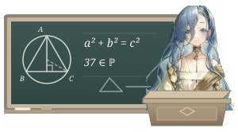
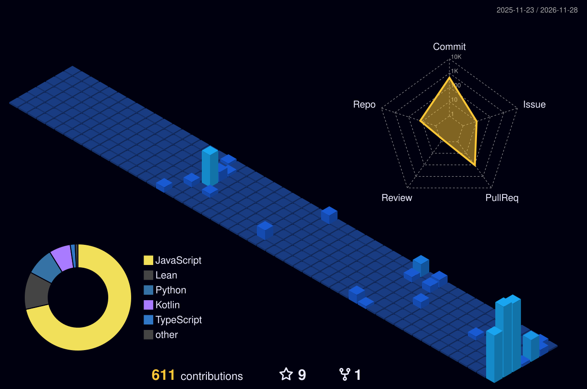

<strong>English</strong> &nbsp; / &nbsp; <a href="https://github.com/Liangebra/Liangebra/blob/main/README.zh-CN.md">简体中文</a> &nbsp; / &nbsp; <a href="https://github.com/Liangebra/Liangebra/blob/main/README.ja.md">日本語</a>

<!-- singularity-art -->

  <picture>
    <source media="(prefers-color-scheme: dark)" srcset="./assets/singularity/hero-dark.svg">
    
  </picture>

## Research interests

I'm an undergraduate studying mathematics and applied mathematics. I particularly like topology, algebra and the structural side of mathematics. I'm also interested in how mathematical language is developed and how we come to understand mathematical objects.

These days I've been working on LeanDuet and contributing to Lean projects. Some of my other repositories come from mathematical modeling competitions or things I wanted to try.

  
   
  <a href="https://github.com/hereisVaibhav/termfolio">Termfolio / ~/.plan</a>

## Projects

### [LeanDuet](https://github.com/Liangebra/leanduet)

*Mathematical language and formalization*

I started this project because I wanted to write mathematics naturally while still being able to work with Lean. The difficult part, I think, is not just translating sentences into code, but understanding what mathematical structure both expressions refer to.

The idea is to let the two expressions share a mathematical structure and allow edits on either side. There is still quite a lot to do.

[Try it](https://liangebra.github.io/leanduet/) / [Research notes](https://github.com/Liangebra/leanduet/blob/main/docs/RESEARCH.md) / [Discussions](https://github.com/Liangebra/leanduet/discussions)

### Theory and formalization

**[Computational Metaknowledge](https://github.com/Liangebra/computational-metaknowledge)**

Computability and what an agent can know. · [Paper](https://github.com/Liangebra/computational-metaknowledge/blob/main/paper/ResearchReport.pdf)

**[Riemann Hypothesis community project](https://github.com/leanprover-community/riemann-hypothesis)**

Work on proof readability, mathematical abstraction and redundant dependencies in the Lean community project. · [My PRs](https://github.com/leanprover-community/riemann-hypothesis/pulls?q=is%3Apr+author%3ALiangebra)

### DeepSeek Harness plugin contributions

<!-- dsh-whale-girl-strip -->

  
  
  
  
  

I develop plugins for [DeepSeek Harness](https://github.com/deepseek-ai/deepseek-harness), with an interest in agent context management and interaction.

**My plugins**

[dsh-smart-compact](https://github.com/Liangebra/dsh-smart-compact) — a context compaction engine with configurable thresholds, automatic compaction, DCP-inspired pruning suggestions, and durable session-log history that preserves original events.

[dsh-esc-enter](https://github.com/Liangebra/dsh-esc-enter) — an interaction plugin adding Esc cancellation and append/stop controls while preserving the host's queue semantics.

**Community contributions**

[whale-girl](https://github.com/vlln/whale-girl) — added a standalone desktop companion with a transparent always-on-top window and live plugin state synchronization. [Merged PR #8](https://github.com/vlln/whale-girl/pull/8).

[dsh-bash-terminal](https://github.com/MAXeaglet/dsh-bash-terminal) — fixed Windows interactive terminal support through direct `node-pty` integration. [Merged PR #2](https://github.com/MAXeaglet/dsh-bash-terminal/pull/2).

### Modeling and software

**[Green Electricity SG-ABM](https://github.com/Liangebra/green-electricity-SGABM)**

An agent-based model of the green electricity market.

**[MathModelEvaluator](https://github.com/Liangebra/MathModelEvaluator)**

A tool that grew out of a mathematical modeling problem.

**[NuBook](https://github.com/Liangebra/Nubook)**

A small Android bookkeeping app.

If you're interested in any of these, feel free to open an issue or discussion. I'd also like to hear from people interested in Lean, type theory or mathematical language.

## GitHub activity

A view of the last year, generated from GitHub activity.

  <picture>
    <source media="(prefers-color-scheme: dark)" srcset="./assets/singularity/telemetry-dark.svg">
    
  </picture>

<!-- contribution-art -->

### Contribution statistics

  <a href="https://github.com/vn7n24fzkq/github-profile-summary-cards"><picture><source media="(prefers-color-scheme: dark)" srcset="https://github-profile-summary-cards.vercel.app/api/cards/profile-details?username=Liangebra&amp;theme=tokyonight"></picture></a>

  <a href="https://github.com/vn7n24fzkq/github-profile-summary-cards"><picture><source media="(prefers-color-scheme: dark)" srcset="https://github-profile-summary-cards.vercel.app/api/cards/stats?username=Liangebra&amp;theme=tokyonight"></picture></a>
  <a href="https://github.com/vn7n24fzkq/github-profile-summary-cards"><picture><source media="(prefers-color-scheme: dark)" srcset="https://github-profile-summary-cards.vercel.app/api/cards/repos-per-language?username=Liangebra&amp;theme=tokyonight"></picture></a>
   
  Activity and language distribution · <a href="https://github.com/vn7n24fzkq/github-profile-summary-cards">Summary Cards</a>

### Contribution visualizations

  
   
  <a href="https://github.com/yoshi389111/github-profile-3d-contrib">3D Contrib</a>

  <a href="https://github.com/abozanona/pacman-contribution-graph"><picture>
    <source media="(prefers-color-scheme: dark)" srcset="./assets/generated/pacman-contribution-graph-dark.svg">
    
  </picture></a>
   
  <a href="https://github.com/abozanona/pacman-contribution-graph">Pac-Man</a>

<!-- monkey-civilization -->

  
   
  <a href="https://github.com/jihoo12/monkeys">Monkey Civilization</a> · A pixel civilization grown from contributions

## My little garden

<!-- yourtomo-pet -->

  <a href="https://github.com/knowprasad/YourTomo"><picture>
    <source media="(prefers-color-scheme: dark)" srcset="./assets/pet/pet.svg">
    
  </picture></a>
   
  <a href="https://github.com/knowprasad/YourTomo">A cat that reacts to my GitHub activity. · YourTomo</a>

<!-- git-bonsai -->

  
   
  <a href="https://github.com/egorthinks/git-bonsai">A bonsai grown from my GitHub history. · Git Bonsai</a>

Artwork: README Templates / Singularity. Thanks to the projects linked above. <a href="https://github.com/Dr-At0mic/README-Templates">README Templates</a> · <a href="https://github.com/journey-ad/Moe-Counter">Moe Counter</a>

<strong>English</strong> &nbsp; / &nbsp; <a href="https://github.com/Liangebra/Liangebra/blob/main/README.zh-CN.md">简体中文</a> &nbsp; / &nbsp; <a href="https://github.com/Liangebra/Liangebra/blob/main/README.ja.md">日本語</a>

