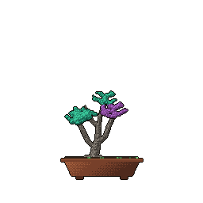

<strong>English</strong> &nbsp; / &nbsp; <a href="https://github.com/Liangebra/Liangebra/blob/main/README.zh-CN.md">简体中文</a> &nbsp; / &nbsp; <a href="https://github.com/Liangebra/Liangebra/blob/main/README.ja.md">日本語</a>

<!-- singularity-art -->

  <picture>
    <source media="(prefers-color-scheme: dark)" srcset="./assets/singularity/hero-dark.svg">
    
  </picture>

## Research interests

I'm an undergraduate studying mathematics and applied mathematics. I particularly like topology, algebra and the structural side of mathematics. I'm also interested in how mathematical language is developed and how we come to understand mathematical objects.

These days I've been working on LeanDuet and contributing to Lean projects. Some of my other repositories come from mathematical modeling competitions or things I wanted to try.

## Projects

### [LeanDuet](https://github.com/Liangebra/leanduet)

I started this project because I wanted to write mathematics naturally while still being able to work with Lean. The difficult part, I think, is not just translating sentences into code, but understanding what mathematical structure both expressions refer to.

The idea is to let the two expressions share a mathematical structure and allow edits on either side. There is still quite a lot to do.

[Try it](https://liangebra.github.io/leanduet/) / [Research notes](https://github.com/Liangebra/leanduet/blob/main/docs/RESEARCH.md) / [Discussions](https://github.com/Liangebra/leanduet/discussions)

### Theory and formalization

- [Computational Metaknowledge](https://github.com/Liangebra/computational-metaknowledge) — A small research project on computability and what an agent can know. [Paper](https://github.com/Liangebra/computational-metaknowledge/blob/main/paper/ResearchReport.pdf).
- [Riemann Hypothesis community project](https://github.com/leanprover-community/riemann-hypothesis) — I've been working on proof readability, mathematical abstraction and redundant dependencies. [My PRs](https://github.com/leanprover-community/riemann-hypothesis/pulls?q=is%3Apr+author%3ALiangebra).

### Modeling and software

- [Green Electricity SG-ABM](https://github.com/Liangebra/green-electricity-SGABM) — An agent-based model of the green electricity market.
- [MathModelEvaluator](https://github.com/Liangebra/MathModelEvaluator) — A tool that grew out of a mathematical modeling problem.
- [NuBook](https://github.com/Liangebra/Nubook) — A small Android bookkeeping app.

If you're interested in any of these, feel free to open an issue or discussion. I'd also like to hear from people interested in Lean, type theory or mathematical language.

## GitHub activity

A view of the last year, generated from GitHub activity.

<!-- singularity-telemetry-pending -->

<!-- contribution-art -->

Other activity views

  
   
  <a href="https://github.com/yoshi389111/github-profile-3d-contrib">3D Contrib</a>

  <a href="https://github.com/abozanona/pacman-contribution-graph"><picture>
    <source media="(prefers-color-scheme: dark)" srcset="./assets/generated/pacman-contribution-graph-dark.svg">
    
  </picture></a>
   
  <a href="https://github.com/abozanona/pacman-contribution-graph">Pac-Man</a>

  <a href="https://github.com/vn7n24fzkq/github-profile-summary-cards"><picture>
    <source media="(prefers-color-scheme: dark)" srcset="https://github-profile-summary-cards.vercel.app/api/cards/profile-details?username=Liangebra&amp;theme=tokyonight">
    
  </picture></a>
   
  <a href="https://github.com/vn7n24fzkq/github-profile-summary-cards">Contribution trend</a>

  <picture>
    <source media="(prefers-color-scheme: dark)" srcset="https://github-profile-summary-cards.vercel.app/api/cards/stats?username=Liangebra&amp;theme=tokyonight">
    
  </picture>

  <picture>
    <source media="(prefers-color-scheme: dark)" srcset="https://github-profile-summary-cards.vercel.app/api/cards/repos-per-language?username=Liangebra&amp;theme=tokyonight">
    
  </picture>

## My little garden

<!-- yourtomo-pet -->

  <a href="https://github.com/knowprasad/YourTomo"><picture>
    <source media="(prefers-color-scheme: dark)" srcset="./assets/pet/pet.svg">
    
  </picture></a>
   
  <a href="https://github.com/knowprasad/YourTomo">A cat that reacts to my GitHub activity. · YourTomo</a>

<!-- git-bonsai -->

  
   
  <a href="https://github.com/egorthinks/git-bonsai">A bonsai grown from my GitHub history. · Git Bonsai</a>

<!-- singularity-end-pending -->

Artwork: README Templates / Singularity. Thanks to the projects linked above. <a href="https://github.com/Dr-At0mic/README-Templates">README Templates</a> · <a href="https://github.com/journey-ad/Moe-Counter">Moe Counter</a>

<strong>English</strong> &nbsp; / &nbsp; <a href="https://github.com/Liangebra/Liangebra/blob/main/README.zh-CN.md">简体中文</a> &nbsp; / &nbsp; <a href="https://github.com/Liangebra/Liangebra/blob/main/README.ja.md">日本語</a>

