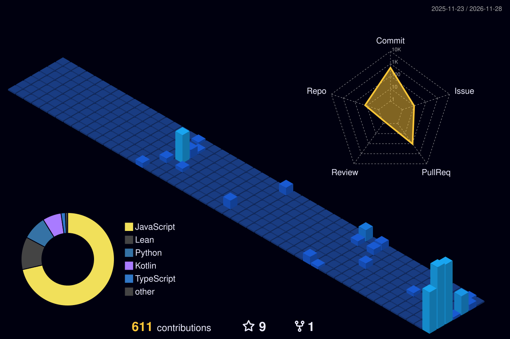

  <h1>Liangebra</h1>
  <a href="https://github.com/Liangebra">English</a> &nbsp; / &nbsp; <strong>简体中文</strong> &nbsp; / &nbsp; <a href="https://github.com/Liangebra/Liangebra/blob/main/README.ja.md">日本語</a>
   
  <picture>
    <source media="(prefers-color-scheme: dark)" srcset="https://readme-typing-svg.demolab.com?font=Noto+Sans+SC&amp;weight=500&amp;size=19&amp;duration=3400&amp;pause=1200&amp;color=A9B1D6&amp;center=true&amp;vCenter=true&amp;width=520&amp;height=48&amp;lines=%E6%95%B0%E5%AD%A6%E4%B8%8E%E5%BA%94%E7%94%A8%E6%95%B0%E5%AD%A6;%E6%8B%93%E6%89%91%20%2F%20%E4%BB%A3%E6%95%B0%20%2F%20Lean">
    <source media="(prefers-color-scheme: light)" srcset="https://readme-typing-svg.demolab.com?font=Noto+Sans+SC&amp;weight=500&amp;size=19&amp;duration=3400&amp;pause=1200&amp;color=5A5893&amp;center=true&amp;vCenter=true&amp;width=520&amp;height=48&amp;lines=%E6%95%B0%E5%AD%A6%E4%B8%8E%E5%BA%94%E7%94%A8%E6%95%B0%E5%AD%A6;%E6%8B%93%E6%89%91%20%2F%20%E4%BB%A3%E6%95%B0%20%2F%20Lean">
    
  </picture>
   
  

## 研究兴趣

我目前是数学与应用数学专业的本科生，比较喜欢拓扑、代数这类偏结构的数学。比起单纯的计算，我更感兴趣的是一个定义为什么会这样提出，以及我们是怎样理解数学对象的。

最近主要在做 LeanDuet，也在参与一些 Lean 的开源工作。其他一些仓库是之前做数学建模时留下的，或者只是觉得有意思就做了。

## 项目与研究

### [LeanDuet](https://github.com/Liangebra/leanduet)

做这个项目最初是想看看能否让数学家直接用平时写数学的方式去使用 Lean。但我觉得比较困难的其实不只是语言的翻译，而是如何理解这两种语言所表达的数学结构。

目前的想法是让它们共用一个数学语义结构，并允许从两边进行修改。这个项目还有很多地方没有解决。

[在线体验](https://liangebra.github.io/leanduet/) / [研究笔记](https://github.com/Liangebra/leanduet/blob/main/docs/RESEARCH.md) / [讨论](https://github.com/Liangebra/leanduet/discussions)

### 理论研究与形式化数学

- [Computational Metaknowledge](https://github.com/Liangebra/computational-metaknowledge)：之前做的一个关于可计算性及 Agent 能够知道什么的研究。[论文](https://github.com/Liangebra/computational-metaknowledge/blob/main/paper/ResearchReport.pdf)。
- [黎曼猜想社区项目](https://github.com/leanprover-community/riemann-hypothesis)：主要在做一些证明可读性、数学抽象及冗余依赖方面的工作。[我的 PR](https://github.com/leanprover-community/riemann-hypothesis/pulls?q=is%3Apr+author%3ALiangebra)。

### 数学建模与软件开发

- [Green Electricity SG-ABM](https://github.com/Liangebra/green-electricity-SGABM)：绿电市场的多智能体仿真模型。
- [MathModelEvaluator](https://github.com/Liangebra/MathModelEvaluator)：之前做一道数模题时觉得这个东西挺有意思，就单独做成了工具。
- [NuBook](https://github.com/Liangebra/Nubook)：一个自己做的极简 Android 记账本。

如果对这些项目感兴趣，可以直接在对应仓库里提 Issue 或发起讨论。也很希望能和对 Lean、类型论或者数学语言感兴趣的朋友交流。

## 开源活动

<b>具体统计与贡献趋势</b>

  <picture><source media="(prefers-color-scheme: dark)" srcset="https://github-profile-summary-cards.vercel.app/api/cards/profile-details?username=Liangebra&amp;theme=tokyonight"></picture>
  <picture><source media="(prefers-color-scheme: dark)" srcset="https://github-profile-summary-cards.vercel.app/api/cards/stats?username=Liangebra&amp;theme=tokyonight"></picture>
  <picture><source media="(prefers-color-scheme: dark)" srcset="https://github-profile-summary-cards.vercel.app/api/cards/repos-per-language?username=Liangebra&amp;theme=tokyonight"></picture>
   
  <a href="https://github.com/vn7n24fzkq/github-profile-summary-cards">GitHub Profile Summary Cards</a>

### 贡献记录的两种表示

这里是同一类贡献数据的两种表示：左边用黑洞吸积盘中的粒子表示每天的活动，右边用立体日历中柱子的高度表示贡献次数。

<!-- singularity-art -->
<!-- contribution-art -->
<table>
  <tr>
    <td width="50%" align="center" valign="middle">
      <a href="https://github.com/Dr-At0mic/README-Templates"><picture><source media="(prefers-color-scheme: dark)" srcset="./assets/singularity/hero-dark.svg"></picture></a>
    </td>
    <td width="50%" align="center" valign="middle">
      
    </td>
  </tr>
  <tr>
    <td align="center"><a href="https://github.com/Dr-At0mic/README-Templates">Singularity / 吸积盘</a></td>
    <td align="center"><a href="https://github.com/yoshi389111/github-profile-3d-contrib">三维贡献日历</a></td>
  </tr>
</table>

  <a href="https://github.com/abozanona/pacman-contribution-graph"><picture><source media="(prefers-color-scheme: dark)" srcset="./assets/generated/pacman-contribution-graph-dark.svg"></picture></a>
   
  <a href="https://github.com/abozanona/pacman-contribution-graph">贡献日历的游戏版本</a>

## 主页一角

放两个个人比较喜欢的项目：一棵随 GitHub 记录生长的盆景，以及一只会随活动变化的猫。

<!-- git-bonsai -->
<!-- yourtomo-pet -->
<table>
  <tr>
    <td width="31%" align="center" valign="middle">
      
    </td>
    <td width="69%" align="center" valign="middle">
      <a href="https://github.com/knowprasad/YourTomo"><picture><source media="(prefers-color-scheme: dark)" srcset="./assets/pet/pet.svg"></picture></a>
    </td>
  </tr>
  <tr>
    <td align="center"><a href="https://github.com/egorthinks/git-bonsai">Git Bonsai / 盆景</a></td>
    <td align="center"><a href="https://github.com/knowprasad/YourTomo">YourTomo / 像素猫</a></td>
  </tr>
</table>

---

图像根据 GitHub 活动生成，点击对应组件名称可查看原项目。 <a href="https://github.com/DenverCoder1/readme-typing-svg">Typing SVG</a> · <a href="https://github.com/journey-ad/Moe-Counter">Moe Counter</a>

<a href="https://github.com/Liangebra">English</a> &nbsp; / &nbsp; <strong>简体中文</strong> &nbsp; / &nbsp; <a href="https://github.com/Liangebra/Liangebra/blob/main/README.ja.md">日本語</a>

